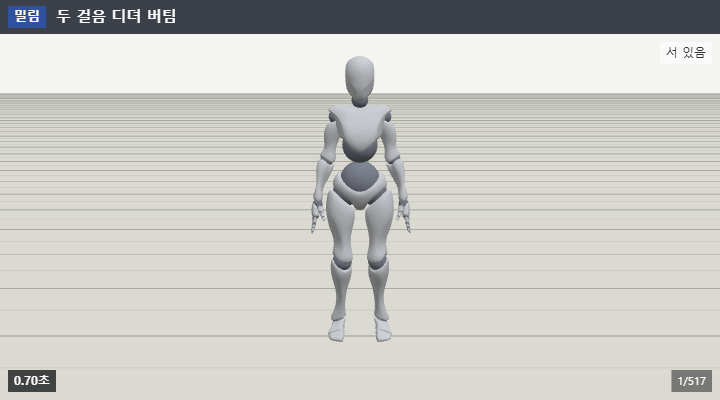
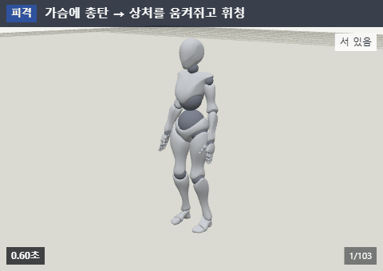
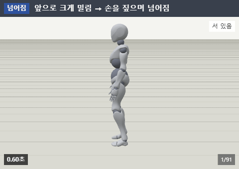
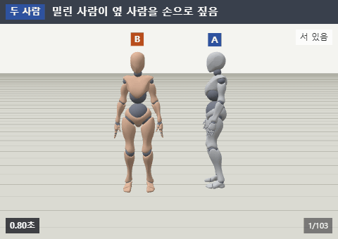
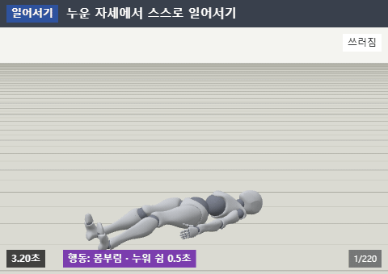
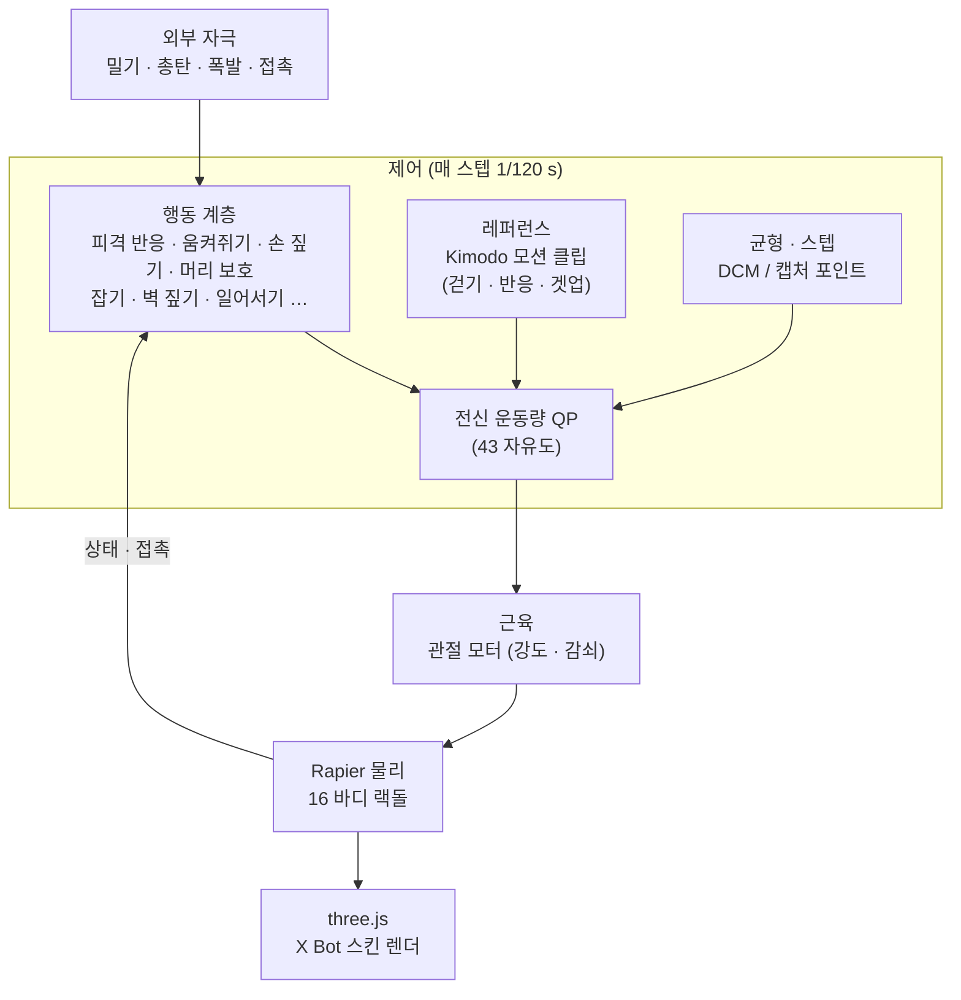

<div align="center">

# Advanced Ragdoll

**웹에서 돌아가는 Euphoria 스타일 액티브 랙돌**

밀리고, 맞고, 넘어지고, 다시 일어서는 반응을 **애니메이션 재생이 아니라 물리**로 —<br>
근육으로 버티고 균형을 잡는 캐릭터를 Rapier + three.js로 만든다.

[](https://junjun612.github.io/advanced-ragdoll/)
[](docs/API.md)
[](docs/ALGORITHMS.md)


<br>



</div>

<br>

## ✨ 무엇이 다른가

일반 랙돌은 맞는 순간 **힘이 빠진 인형**이 된다. 애니메이션 기반 피격은 **늘 같은 동작**을 재생한다.
Advanced Ragdoll의 캐릭터는 매 순간 근육으로 자세를 유지하면서, 충격의 방향·세기·부위·지형에 따라 **매번 다르게** 반응한다.

- 🦶 **버티기** — 캡처 포인트(DCM) 기반 균형과 스텝으로, 밀리면 발을 디뎌 버틴다
- 🎯 **맞기** — 총탄·근접·폭발을 맞은 부위가 꺾이고, 상처를 움켜쥐고, 다리를 맞으면 절뚝인다
- 🤲 **넘어지기** — 넘어지는 방향을 예측해 손을 짚고, 머리를 감싸고, 구른다
- 🧍 **일어서기** — 누운 자세를 인식해 맞는 겟업 동작으로 스스로 일어선다
- 🧱 **환경** — 계단·경사·모서리·난간·벽, 다른 캐릭터와 날아오는 물체에 반응한다
- 🎬 **자연스러움** — 걷기·일어서기·반응 동작은 생성 AI(Kimodo) 모션을 근육 목표로 따라간다

<br>

## 🎞️ 갤러리

<table>
<tr>
<td align="center" width="50%"><br><b>총탄 · 상처 움켜쥐기</b><br><sub>가슴에 총탄 → 움켜쥐고 휘청이며 버팀</sub></td>
<td align="center" width="50%"><br><b>손 짚으며 넘어지기</b><br><sub>앞으로 크게 밀림 → 손이 먼저 바닥에 닿음</sub></td>
</tr>
<tr>
<td align="center"><br><b>두 사람</b><br><sub>밀린 사람이 옆 사람을 손으로 짚고 버팀</sub></td>
<td align="center"><br><b>일어서기</b><br><sub>누운 자세를 인식해 스스로 일어섬</sub></td>
</tr>
</table>

<sub>모든 장면은 같은 캐릭터 · 같은 설정 · 키프레임 없이 물리로 계산된 결과다. 화면 속 라벨은 디버그 표시(활성 행동, 균형 전략, 넘어짐 확실도 등).</sub>

<br>

## 🚀 빠른 시작

```bash
git clone https://github.com/junjun612/advanced-ragdoll.git
cd advanced-ragdoll
npm ci
npm run dev        # → http://localhost:5173
```

브라우저에서 시나리오를 고르거나, 캐릭터를 직접 **밀고 · 쏘고 · 폭발시키고 · 상자를 던져** 보자.

### 코드에서 쓰기

```ts
import { World } from './src/sim/api';
import xbot from './config/characters/xbot.json';
import ragdoll from './config/ragdoll.json';

const world = await World.create({ seed: 1 });          // 고정 스텝 1/120 s, 결정론
const hero = world.addCharacter(xbot, ragdoll, {
  position: [0, 0, 0], yaw: 0, state: 'Active', pose: 'stand',
});

hero.on('fell',  (e) => console.log('넘어짐', e.t));
hero.on('gotUp', (e) => console.log('일어섬', e.t));

// 가슴을 앞에서 중간 세기로 민다 — 세기는 전신 질량중심 속도 변화 Δv(m/s)
hero.hit({ type: 'push', body: 'Spine2', direction: [0, 0, -1], magnitude: 'medium' });

// 오른 허벅지에 총탄
hero.hit({ type: 'bullet', body: 'RightUpLeg', direction: [0, 0, -1], magnitude: 0.35 });

function frame(dt: number) {
  world.advance(dt);              // 필요한 만큼 고정 스텝
  draw(hero.getState().bodies);   // 바디별 위치 · 회전
}
```

전체 API — 이벤트, 상태 저장·복원(`World.save / load`), 행동 트리거, 근육 세기 조절 — 는 **[docs/API.md](docs/API.md)**.

<br>

## 🧠 동작 원리



| 층 | 하는 일 |
|---|---|
| **근육** | 관절 모터가 목표 자세로 당긴다. 맞은 부위는 잠깐 힘이 빠지고 서서히 회복한다 |
| **균형 · 스텝** | 질량중심이 넘어갈 곳(캡처 포인트)을 예측해 발목·엉덩이 전략을 쓰고, 안 되면 발을 디딘다 |
| **전신 QP** | 균형·자세·손 과제를 동시에 만족하는 관절 가속도와 접촉력을 푼다 |
| **행동** | 상황(맞음, 넘어지는 중, 누움, 손이 닿는 난간 …)에 맞는 행동을 섞는다 — 23종 |
| **레퍼런스** | 생성 AI 모션을 "목표"로만 쓴다. 따라가는 건 언제나 물리다 |

**정직한 보조 힘.** 몸을 허공에서 잡아 주는 숨은 힘은 없다. 필요한 보조(루트 · 핀 · 겟업)는 명시적으로 켜고 끄며, 사용량을 매 프레임 기록한다. 피격 반응 중 핀 보조는 0이다.

**결정론.** 같은 시드면 Node에서 바이트 단위로 같은 결과가 나온다. 82개 시나리오가 회귀 테스트로 이를 지킨다.

<br>

## 📏 사람다움을 숫자로

통과/실패보다 **사람처럼 보이는가**가 목표다. 사람 모션 레퍼런스와 비교한 지표로 판정한다.

| 지표 | 사람 | 지금 | 목표 |
|---|:---:|:---:|:---:|
| 밀린 뒤 팔 들림 (상위 10%) | 33° | 56° | 38° |
| 팔 사용량 | 78°/s | 101°/s | 102°/s |
| 몸통 최대 기울기 | 16° | 28° | 21° |
| 근처 입력 넘어짐률 | 0% | 11% | 5% |

<sub>근처 입력 138회 통계 (`config/qualityTargets.json`). 시나리오 하나가 아니라 시드 묶음으로 잰다 — 액티브 랙돌은 작은 차이에도 결과가 갈리는 혼돈계이기 때문이다.</sub>

<br>

## 🗺️ 로드맵

- [x] **v0.0 – v0.2** 기술 검증 · X Bot 랙돌 자동 생성 · 근육
- [x] **v0.3 – v0.4** 균형(전신 QP) · 스텝
- [x] **v0.5** 피격 · 넘어짐 · 공중 · 바닥 행동
- [x] **v0.6 – v0.7** Kimodo 걷기 추종 · 일어서기
- [x] **v0.8** 지형 · 잡기 · 벽 · 캐릭터 간 충돌 · 프롭
- [ ] **v0.9** 자동 튜닝 · 퍼징 1만 회 · API 확정 *(진행 중)*
- [ ] **v1.0** 앱 완성 · 실시간 성능 · 최종 검토
- [ ] **언젠가** 학습형 추종기 — 모션 레퍼런스를 강화학습으로 따라가 더 사람답게 (보류)

<br>

## 🛠️ 개발

```bash
npm test                          # 단위 테스트 (vitest)
npm run sim:all                   # 전체 시나리오 → out/report.md
npm run sim -- push_left_medium   # 시나리오 하나 → out/<이름>/log.jsonl, summary.json
npm run film -- push_left_medium  # 필름스트립 (0.1초 간격 컷 + 디버그 라벨)
npx tsx tools/reel.ts             # 하이라이트 GIF · MP4
npx vite build                    # 웹 데모 → dist/
```

| 문서 | 내용 |
|---|---|
| [SPEC.md](SPEC.md) | 전체 명세 — 목표, 원칙, 마일스톤, 시나리오, 품질 지표 |
| [docs/API.md](docs/API.md) | 공개 API |
| [docs/ALGORITHMS.md](docs/ALGORITHMS.md) | 근육 · 균형 · 스텝 · 행동 알고리즘 |
| [docs/KIMODO.md](docs/KIMODO.md) | 생성 AI 모션 클립 만들기 · 고르기 |
| [docs/DEVLOG.md](docs/DEVLOG.md) | 진행 상황과 결정 기록 (날짜 · 결정 · 이유 · 대안) |
| [docs/RESEARCH_APPROACHES.md](docs/RESEARCH_APPROACHES.md) | 접근법 조사 — 해석적 제어 vs 학습형 추종기 |

<br>

## 🙏 크레딧

- 물리 — [Rapier](https://rapier.rs) · 렌더 — [three.js](https://threejs.org)
- 캐릭터 — X Bot, [Mixamo](https://www.mixamo.com) (Adobe). 캐릭터 모델로만 쓰며 Mixamo 애니메이션은 쓰지 않는다
- 모션 — Kimodo로 생성한 걷기 · 반응 · 겟업 클립 (`assets/poses`)
- 영감 — NaturalMotion Euphoria, PuppetMaster, DReCon

<div align="center">
<br>
<sub>버티다가, 휘청이다가, 넘어지고, 다시 일어선다.</sub>
</div>
